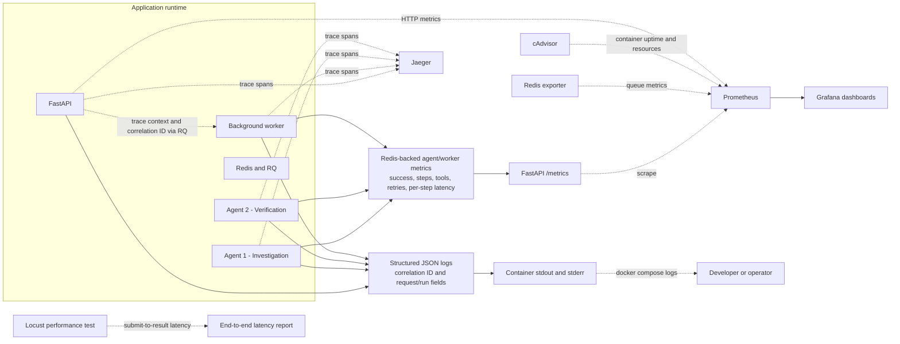
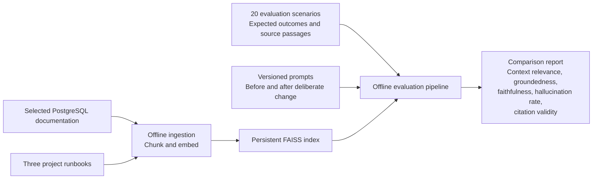

<h1 align="center">PostgreSQL Incident Triage Assistant</h1>

<p align="center">
  <strong>Investigate database incidents. Get safe next steps with runbook sources.</strong>
</p>

<p align="center">
  
  
  
  
  
  
  
  
  
  
  
  
  
</p>

<p align="center">
  Triage synthetic or replayed database alerts for high latency, connection exhaustion, and increasing disk usage. The FastAPI service uses supplied alert/context data and deterministic synthetic diagnostics only; it never connects to a live system or performs remediation.
</p>

---

## Project layout

```text
.
├── app/
│   ├── api/                                 # FastAPI routes and UI
│   ├── core/                                # environment settings and observability
│   ├── domain/                              # models, policies, safety, runbook types
│   ├── services/                            # triage, agents, retrieval, service ports
│   ├── infrastructure/
│   │   ├── diagnostics/                     # deterministic synthetic fixtures
│   │   ├── llm/                              # provider resilience and local model stub
│   │   ├── queue/                           # Redis/RQ queue and worker
│   │   ├── rag/                             # Groq, ingestion, and FAISS adapters
│   │   └── storage/                         # SQLite incident history
│   ├── main.py, worker.py                   # stable API and RQ entry points
│   └── __init__.py
├── corpus/runbooks/                         # the three selected runbooks
├── data/                                    # local SQLite history and optional RAG files
├── docs/                                    # brief, architecture, evaluation, operations
├── grafana/                                 # dashboard definitions
├── results/                                 # Locust CSV output
├── scripts/                                 # benchmarks, load tests, evaluation
├── tests/                                   # API, policy, queue, and RAG tests
├── .dockerignore, .env.example, .gitignore, README.md
└── Dockerfile, docker-compose.yml, prometheus.yml, pyproject.toml, uv.lock
```

The API, domain, services, and infrastructure layers have separate
responsibilities. `app.main:app` and `app.worker.process_triage` remain stable
entry points. RAG separates ingestion, indexing/storage, and generation; the
default triage path does not require RAG.
The original project brief is preserved in
[docs/MiniProject_08_Incident_Triage_Runbook_MLSD.txt](docs/MiniProject_08_Incident_Triage_Runbook_MLSD.txt).

## Architecture workflow

```mermaid
flowchart LR
    Alert[1. Synthetic or replayed alert<br/>Built-in scenario or recorded payload]
    UI[2. Frontend dashboard<br/>Submit alert and view result]
    API[3. FastAPI<br/>Validate request and quarantine invalid input]
    Queue[4. Redis queue and background worker<br/>Asynchronous run]
    Agent1[5. Multi-agent analysis<br/>Agent 1 investigates and gathers evidence]
    Tools[Shared tools<br/>Request lookup, corpus search, clause lookup]
    Mode{Retrieval mode}
    Keyword[Keyword search<br/>Default]
    FAISS[FAISS semantic search<br/>Optional RAG]
    Knowledge[6. Runbook knowledge<br/>Three runbooks and indexed documentation]
    Evidence[Retrieved passages and citations]
    Policy[7. Deterministic severity and routing]
    Candidate[Proposed cause, severity and steps<br/>with retrieved passages and citations]
    Agent2[5. Agent 2 - Verification and routing]
    Verified{Complete recommendation verified?}
    Retry{Alternate retrieval used?}
    Alternate[Alternate search strategy<br/>One retry]
    Recommendation[8. Verified recommendation<br/>Citations and safe first-response steps]
    Escalation[Human escalation<br/>Withhold unsupported recommendation]
    Result[9. SQLite history and Redis run status]
    Display[Frontend displays result]
    Quarantine[Quarantine invalid request]

    Alert --> UI --> API --> Queue --> Agent1
    API -. invalid payload .-> Quarantine
    Agent1 --> Tools --> Mode
    Mode -- Default --> Keyword
    Mode -- RAG enabled --> FAISS
    Knowledge --> Keyword
    Knowledge --> FAISS
    Keyword --> Evidence
    FAISS --> Evidence
    Evidence --> Policy --> Candidate --> Agent2 --> Verified
    Verified -- Yes --> Recommendation --> Result
    Verified -- No --> Retry
    Retry -- No --> Alternate --> Evidence
    Retry -- Yes --> Escalation --> Result
    Result --> Display
    Display -. feedback .-> API
```



Agent 2 verifies the complete proposed assessment: cause, severity,
recommended steps, retrieved passages, and citations. A failed check triggers
one alternate search and a second verification; if that also fails, the
unsupported recommendation is withheld and the incident is escalated.
Keyword search is the default retrieval path; enabling RAG switches corpus
search to FAISS semantic retrieval. Both are supporting tools used during
investigation.

### Diagram 2 - Application observability



Prometheus and Grafana observe the triage application and its infrastructure;
they do not detect incidents on a live PostgreSQL system. Jaeger receives
OpenTelemetry traces. Application logs are available from the local Compose
containers as structured JSON with correlation IDs; view them with
`docker compose logs`. There is no centralized log backend. Per-agent success
rates, steps/tool calls per run, verification retry rate, and per-step latency
are exported through the API metrics endpoint. The worker histogram measures
worker execution; Locust measures submit-to-final-result latency, including
queue wait. cAdvisor supplies container uptime and resource metrics.

### Diagram 3 - Offline LLMOps and evaluation



The three diagrams separate the request path from observability and offline
development; ingestion and evaluation do not run on an incident request.

### Runtime design notes

- **Guardrails:** request schemas and local input/output checks protect
  model-bound incident, context, and retrieved text. Flagged input bypasses
  model calls. Summary output is checked for selected toxic phrases, unsafe
  remediation, unsupported cause assertions, length, and citations; rejected
  summaries leave deterministic triage in place. These pattern-based checks
  are not a general-purpose prompt-injection or toxicity classifier.
- **Agent and retrieval limits:** Agent 1 investigates with the shared
  request-lookup, corpus-search, and clause-lookup tools; Agent 2 verifies
  sources and citations. Tool selection is limited to four rounds and eight
  calls, verification gets at most one alternate retrieval, and RQ jobs have a
  120-second timeout.
- **Reliability and policy:** RAG and model-selected tools are optional.
  Bounded provider retries and a circuit breaker protect model calls; failures
  fall back to deterministic retrieval/triage. Severity, routing, and
  remediation recommendations remain deterministic and advisory.
- **LLMOps and observability:** prompt versions, model token usage, and
  provider token counts are recorded; cost estimates are included when token
  prices are configured. OpenTelemetry traces, application metrics, and
  queue/worker outcomes support operational diagnosis.
- **Platform and performance:** Redis/RQ tracks run status, SQLite stores
  incident history and feedback, and a bounded in-process LRU caches retrieval.
  `RATE_LIMIT_PER_MINUTE` controls submission rate. Locust measures full
  submit-to-result latency; see [docs/evaluation.md](docs/evaluation.md) for
  worker scaling and results.

The offline evaluator compares versioned RAG prompts on the same scenario set
and reports before/after deltas. Groundedness and faithfulness are reproducible
lexical proxies, not semantic or human-judged scores; details are in
[docs/evaluation.md](docs/evaluation.md). Further operational behavior is
documented in [docs/architecture.md](docs/architecture.md) and
[docs/service-operations.md](docs/service-operations.md).

## Getting started

Requirements: Git, Docker, and Docker Compose. Clone the repository and start
the services:

```powershell
git clone https://github.com/proindra/Production-Incident-Triage.git
Set-Location Production-Incident-Triage
docker compose up --build
```

The default setup needs no `.env` file, Groq key, or database URL. It uses
synthetic or replayed alerts and deterministic diagnostics; RAG and
model-selected tools are disabled until configured. Compose starts the API,
Redis/RQ, worker, local model stub, Redis exporter, Prometheus, Grafana,
cAdvisor, and Jaeger. No live database or external monitoring target is
connected.

Open the UI at <http://127.0.0.1:8000/> or the API docs at
<http://127.0.0.1:8000/docs>. `GET /health` checks that the API process is
responsive; `/metrics` exposes API metrics. `POST /incidents/triage` returns
`202 Accepted` with a `run_id`. Poll the returned `status_url` until the run is
finished or failed. The worker verifies citations before returning a
recommendation and escalates instead of returning an unsupported answer.
`GET /ready` checks Redis availability; `GET /health` checks API liveness.

To try the difficult WAL-retention scenario in the UI, enter this incident
description and context. The equivalent backwards-compatible API request is:

```json
{
  "incident_description": "Disk usage on the primary is climbing steadily. Table and index sizes are not growing. Disk filling, cause unknown.",
  "context": {
    "disk_used_percent": 88,
    "disk_growth": "increasing",
    "table_index_sizes": "stable"
  }
}
```

Expect disk/WAL triage with medium severity. WAL retention should be described
as a possible cause, not a confirmed one; the supplied metrics are synthetic
and no live diagnostic checks are performed.

The API also accepts a structured synthetic alert payload with an explicit
on-call note:

```json
{
  "alert": {
    "incident_type": "disk_usage_increasing",
    "database": "app_db",
    "environment": "demo",
    "postgres_version": "17",
    "metrics": {
      "disk_used_percent": 88,
      "disk_growth": "increasing",
      "table_index_sizes": "stable"
    }
  },
  "on_call_note": "Disk filling; table and index sizes are stable."
}
```

Malformed payloads receive field-level `422` errors and a quarantine ID; they
are persisted and do not enter the queue. The response includes observed facts,
hypotheses, recommendations, citation-verification outcome, severity, route,
and agent/tool trace. Context fields and numeric ranges are validated and
bounded. `RUNBOOKS_PATH` is honored by the worker.

Scale the worker replicas with:

```powershell
docker compose up --build --scale agent-worker=3
```

## Optional Groq and FAISS RAG

The default remains deterministic and makes no Groq requests. To enable the
RAG path, copy `.env.example` to `.env` and set `RAG_ENABLED=true`,
`GROQ_API_KEY`, `GROQ_MODEL`, and `RAG_EMBEDDING_MODEL` to values you select
from the provider and embedding runtime. The key and model names are runtime
configuration and must not be committed. Compose passes the Groq key to worker
containers only.

Build the local FAISS index before starting RAG workers:

```powershell
Copy-Item .env.example .env
# Edit .env locally and set the RAG values above.
docker compose build agent-worker
docker compose run --rm agent-worker uv run --no-sync python -m app.infrastructure.rag.document_ingestion.fetch_docs --version 17 --destination /data/postgresql
docker compose run --rm agent-worker uv run --no-sync python -m app.infrastructure.rag.document_ingestion
docker compose up --build -d --scale agent-worker=3
```

Ingestion preserves Markdown headings and chunks each runbook into
approximately `RAG_CHUNK_SIZE`-character passages. FastEmbed creates local
embeddings; normalized vectors are searched by cosine similarity through
FAISS. The fetch step adds selected official PostgreSQL 17 documentation
sources to the index in addition to the three project runbooks. Re-running
ingestion embeds only changed/new passages, removes deleted ones, and rebuilds
all vectors only if the embedding model changes. The model files and index are
stored under the shared `/data` volume.

The LangGraph search tool uses FAISS in RAG mode. Groq generates a short
summary from retrieved passages; source citations are checked, and deterministic
severity, routing, and recommended actions remain authoritative. If generation
fails or its citations are invalid, the result clearly reports that it used
deterministic triage instead. The request description, redacted context, and
retrieved excerpts are sent to Groq when this mode is enabled. Do not send
confidential incident data unless your organization approves that provider use.

### Optional model-selected agent tools

Set `AGENT_TOOL_SELECTION_ENABLED=true` to let Groq select among the
request-field, corpus-search, and clause-lookup tools. The default is disabled;
the bounded deterministic flow remains available as a fallback, and model
selection cannot change severity, recommended actions, or perform remediation.
The option requires `GROQ_API_KEY` and `GROQ_MODEL`, but not RAG embeddings. For
a local compatibility check, configure the worker with
`GROQ_API_KEY=stub`, `GROQ_MODEL=stub-model`, and
`GROQ_BASE_URL=http://model-stub:8010/openai/v1`; the Compose `model-stub`
service is deterministic and does not contact Groq.

### RAG prompt evaluation

The evaluator runs on the host and uses the local `data/postgresql` and
`data/faiss` paths; the Compose index is stored in a separate named volume.
Export `GROQ_API_KEY`, `GROQ_MODEL`, and `RAG_EMBEDDING_MODEL` into the current
PowerShell session (a local `.env` file is loaded by Compose, not by `uv run`),
then fetch and index the corpus locally and compare the versioned prompts:

```powershell
uv run --locked python -m app.infrastructure.rag.document_ingestion.fetch_docs --version 17 --destination data/postgresql
uv run --locked python -m app.infrastructure.rag.document_ingestion
uv run --locked python -m scripts.evaluate_rag --output results/rag-evaluation.json
```

The report includes expected-source retrieval accuracy, sentence-level
groundedness, lexical faithfulness/hallucination proxies, citation validity,
before/after deltas, and per-case token/cost metadata. The lexical scores are
not semantic judgments; consult
[docs/evaluation.md](docs/evaluation.md) for their definitions and limitations.
The command makes model calls and can incur provider charges.

## Synthetic and replayed alerts

The project does not connect to a live database or monitoring system. Use the
browser's **Load a synthetic sample** selector or submit a recorded alert
payload to `POST /incidents/triage`. The sample metrics are user-supplied
scenario data; the worker does not collect or invent live measurements.
Severity, routing, retrieval, and evidence verification run on that supplied
payload.

## Monitoring stack

The supplied Compose and Prometheus files are the local development setup.
They expose the API at `localhost:8000`, Prometheus at `localhost:2027`,
Grafana at `localhost:2028`, and Jaeger at `localhost:2030`. Metrics cover the
triage service and local container/queue health; PostgreSQL metrics are not
scraped.

### Local container access and credentials

| Service/container | Local address | Username | Password | Notes |
|---|---|---|---|---|
| Grafana (`irt-grafana`) | <http://localhost:2028> | `admin` | `local_grafana_password` | Grafana UI login. |
| Prometheus (`irt-prometheus`) | <http://localhost:2027> | None | None | No authentication is configured in the supplied local Compose setup. |
| Triage API | <http://localhost:8000> | None | None | No authentication is configured; run locally only. |

Prometheus and the API are unauthenticated in this development setup. Do not
expose them to an untrusted network.

```powershell
docker compose config
docker compose up --build -d
docker compose ps
```

Check <http://localhost:2027/targets> for the configured local service scrape
targets. Traces are available in Jaeger at <http://localhost:2030>. In Grafana, add a
Prometheus data source with URL `http://irt-prometheus:9090` (Grafana must use
the container-network URL, not `localhost:2027`).
The checked-in dashboard at
[`grafana/incident-triage-dashboard.json`](grafana/incident-triage-dashboard.json)
contains triage API, worker, queue, and local container metrics only. Import it
from Grafana's dashboard UI and select the `Incident Triage Prometheus` data
source. It does not display PostgreSQL target metrics.

## Safety and limitations

- Triage is advisory; no remediation endpoint or automatic database change
  exists. Dropping slots, deleting WAL, terminating sessions, and changing
  server settings are explicitly refused.
- User context is treated as reported evidence, not as a diagnostic result.
- Severity thresholds are project defaults in `app/domain/policies.py`; teams should
  replace them with their approved incident policy.
- The default uses keyword retrieval; optional RAG mode uses local embeddings
  and FAISS, while citations are checked against the original runbook text.
- The default SQLite history is local at `data/incidents.db` and is not intended
  as shared or production storage.
- The demo UI is intentionally small and should be protected behind suitable
  authentication and network controls before any shared deployment.
- Deterministic triage is the default. Optional Groq generation records prompt
  versions and token counts; cost estimates require configured token prices.
  Local lexical safety checks and the prompt evaluation workflow are included,
  but they are not a substitute for human review or a general-purpose safety
  classifier.

See [architecture and failure behavior](docs/architecture.md),
[service operations and incident log](docs/service-operations.md), and
the [evaluation guide](docs/evaluation.md).
