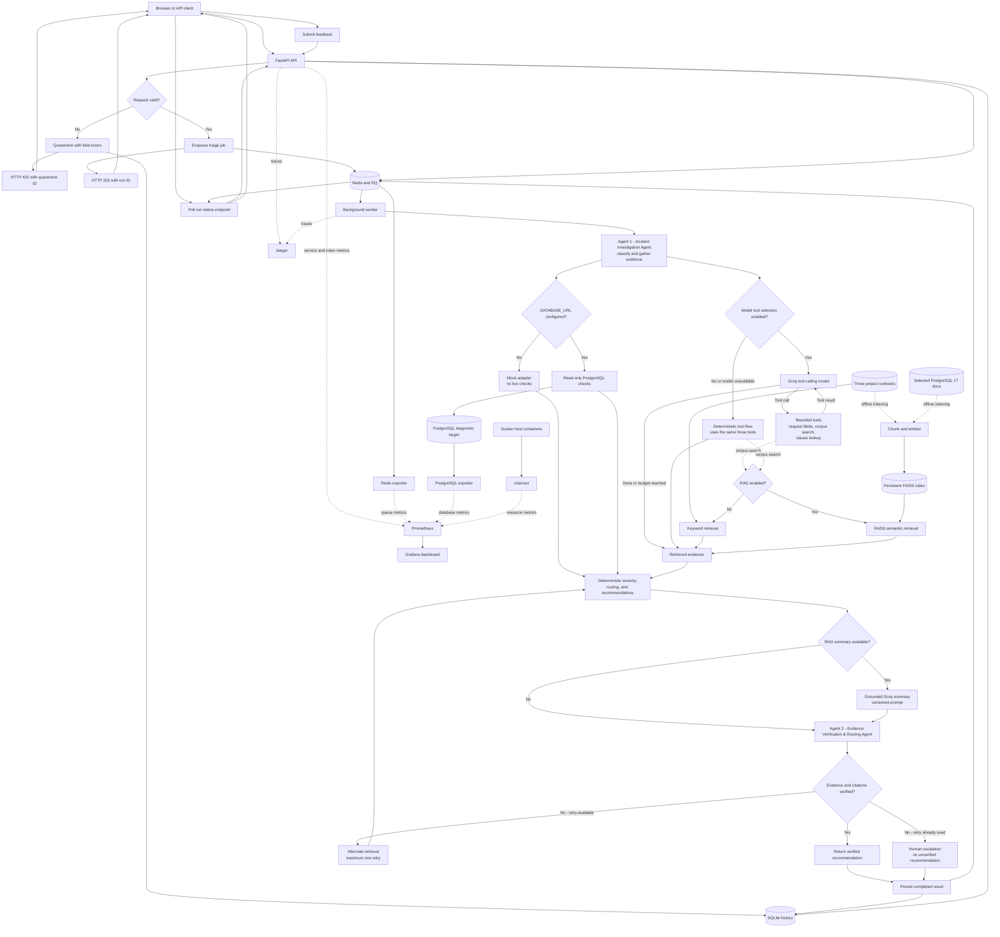

<h1 align="center">PostgreSQL Incident Triage Assistant</h1>

<p align="center">
  <strong>Investigate database incidents. Get safe next steps with runbook sources.</strong>
</p>

<p align="center">
  
  
  
  
  
  
  
  
  
  
  
</p>

<p align="center">
  Triage high database latency, connection exhaustion, and increasing disk usage with evidence-based recommendations and citations from the project runbooks. The FastAPI service uses deterministic mock diagnostics by default, with optional read-only PostgreSQL checks. It distinguishes observed evidence from hypotheses and never performs production remediation.
</p>

---

## Project layout

```text
.
├── app/
│   ├── api/                                 # FastAPI routes and UI
│   ├── core/                                # environment settings and observability
│   ├── domain/                              # models, policies, safety, runbook types
│   ├── services/                            # triage, agents, retrieval, service ports
│   ├── infrastructure/
│   │   ├── diagnostics/                     # mock and read-only PostgreSQL adapters
│   │   ├── llm/                              # provider resilience and local model stub
│   │   ├── queue/                           # Redis/RQ queue and worker
│   │   ├── rag/                             # Groq, ingestion, and FAISS adapters
│   │   └── storage/                         # SQLite incident history
│   ├── main.py, worker.py                   # stable API and RQ entry points
│   └── __init__.py
├── corpus/runbooks/                         # the three selected runbooks
├── data/                                    # local SQLite history and optional RAG files
├── docs/                                    # brief, architecture, evaluation, operations
├── grafana/                                 # dashboard definitions
├── results/                                 # Locust CSV output
├── scripts/                                 # benchmarks, load test, database setup
├── tests/                                   # API, policy, queue, and RAG tests
├── .dockerignore, .env.example, .gitignore, README.md
└── Dockerfile, docker-compose.yml, prometheus.yml, pyproject.toml, uv.lock
```

The API, domain, services, and infrastructure layers have separate
responsibilities. `app.main:app` and `app.worker.process_triage` remain stable
entry points. RAG separates ingestion, indexing/storage, and generation; the
default triage path does not require RAG.
The original project brief is preserved in
[docs/MiniProject_08_Incident_Triage_Runbook_MLSD.txt](docs/MiniProject_08_Incident_Triage_Runbook_MLSD.txt).

## Architecture workflow



Valid requests are processed asynchronously; the API returns a run ID while
Agent 1 (Incident Investigation Agent) classifies the incident and gathers
evidence. Agent 2 (Evidence Verification & Routing Agent) verifies the
evidence and citations. A failed verification triggers at most one alternate
retrieval; if verification still fails, the result is escalated without an
unsupported recommendation. Tool selection can be model-driven or use the
bounded deterministic flow. RAG and Groq summaries are optional; severity,
routing, and recommended actions remain deterministic. SQLite keeps incident
metadata, rejected-request records, and feedback; Redis/RQ tracks job status
and results. Model tool selection is limited to four rounds and eight total
tool calls per run.

## Run with Docker Compose

Requirements: Docker Compose. Compose builds and starts the API, Redis task
queue, scalable agent worker, local model stub, PostgreSQL diagnostic target,
exporters, Prometheus, Grafana, cAdvisor, and Jaeger. The API and worker run in
containers; deterministic mock diagnostics are used unless `DATABASE_URL` is
configured.

```powershell
docker compose up --build
```

Open the UI at <http://127.0.0.1:8000/> or the API docs at
<http://127.0.0.1:8000/docs>. `GET /health` checks that the API process is
responsive; `/metrics` exposes API metrics. `POST /incidents/triage` returns
`202 Accepted` with a `run_id`. Poll the returned `status_url` until the run is
finished or failed. The worker verifies citations before returning a
recommendation and escalates instead of returning an unsupported answer.
`GET /ready` checks Redis availability; `GET /health` checks API liveness.

The backwards-compatible description form is:

```json
{
  "incident_description": "Disk usage increasing while table/index sizes remain stable",
  "context": {
    "disk_used_percent": 88,
    "disk_growth": "increasing",
    "table_index_sizes": "stable"
  }
}
```

The typed alert form supports an explicit on-call note:

```json
{
  "alert": {
    "incident_type": "disk_usage_increasing",
    "database": "app_db",
    "environment": "demo",
    "postgres_version": "17",
    "metrics": {
      "disk_used_percent": 88,
      "disk_growth": "increasing",
      "table_index_sizes": "stable"
    }
  },
  "on_call_note": "Disk filling; table and index sizes are stable."
}
```

Malformed payloads receive field-level `422` errors and a quarantine ID; they
are persisted and do not enter the queue. The response includes observed facts,
hypotheses, recommendations, citation-verification outcome, severity, route,
and agent/tool trace. Context fields and numeric ranges are validated and
bounded. `RUNBOOKS_PATH` is honored by the worker.

Scale the worker replicas with:

```powershell
docker compose up --build --scale agent-worker=3
```

## Optional Groq and FAISS RAG

The default remains deterministic and makes no Groq requests. To enable the
RAG path, copy `.env.example` to `.env` and set `RAG_ENABLED=true`,
`GROQ_API_KEY`, `GROQ_MODEL`, and `RAG_EMBEDDING_MODEL` to values you select
from the provider and embedding runtime. The key and model names are runtime
configuration and must not be committed. Compose passes the Groq key to worker
containers only.

Build the local FAISS index before starting RAG workers:

```powershell
Copy-Item .env.example .env
# Edit .env locally and set the RAG values above.
docker compose build agent-worker
docker compose run --rm agent-worker uv run --no-sync python -m app.infrastructure.rag.document_ingestion.fetch_docs --version 17 --destination /data/postgresql
docker compose run --rm agent-worker uv run --no-sync python -m app.infrastructure.rag.document_ingestion
docker compose up --build -d --scale agent-worker=3
```

Ingestion preserves Markdown headings and chunks each runbook into
approximately `RAG_CHUNK_SIZE`-character passages. FastEmbed creates local
embeddings; normalized vectors are searched by cosine similarity through
FAISS. The fetch step adds selected official PostgreSQL 17 documentation
sources to the index in addition to the three project runbooks. Re-running
ingestion embeds only changed/new passages, removes deleted ones, and rebuilds
all vectors only if the embedding model changes. The model files and index are
stored under the shared `/data` volume.

The LangGraph search tool uses FAISS in RAG mode. Groq generates a short
summary from retrieved passages; source citations are checked, and deterministic
severity, routing, and recommended actions remain authoritative. If generation
fails or its citations are invalid, the result clearly reports that it used
deterministic triage instead. The request description, redacted context, and
retrieved excerpts are sent to Groq when this mode is enabled. Do not send
confidential incident data unless your organization approves that provider use.

### Optional model-selected agent tools

Set `AGENT_TOOL_SELECTION_ENABLED=true` to let Groq select among the
request-field, corpus-search, and clause-lookup tools. The default is disabled;
the bounded deterministic flow remains available as a fallback, and model
selection cannot change severity, recommended actions, or perform remediation.
The option requires `GROQ_API_KEY` and `GROQ_MODEL`, but not RAG embeddings. For
a local compatibility check, configure the worker with
`GROQ_API_KEY=stub`, `GROQ_MODEL=stub-model`, and
`GROQ_BASE_URL=http://model-stub:8010/openai/v1`; the Compose `model-stub`
service is deterministic and does not contact Groq.

### RAG prompt evaluation

The evaluator runs on the host and uses the local `data/postgresql` and
`data/faiss` paths; the Compose index is stored in a separate named volume.
Export `GROQ_API_KEY`, `GROQ_MODEL`, and `RAG_EMBEDDING_MODEL` into the current
PowerShell session (a local `.env` file is loaded by Compose, not by `uv run`),
then fetch and index the corpus locally and compare the versioned prompts:

```powershell
uv run --locked python -m app.infrastructure.rag.document_ingestion.fetch_docs --version 17 --destination data/postgresql
uv run --locked python -m app.infrastructure.rag.document_ingestion
uv run --locked python -m scripts.evaluate_rag --output results/rag-evaluation.json
```

The report includes expected-source retrieval accuracy, sentence-level
groundedness, lexical faithfulness/hallucination proxies, citation validity,
before/after deltas, and per-case token/cost metadata. The lexical scores are
not semantic judgments; consult
[docs/evaluation.md](docs/evaluation.md) for their definitions and limitations.
The command makes model calls and can incur provider charges.

## Optional live PostgreSQL diagnostics

Without `DATABASE_URL`, the service uses an empty deterministic mock adapter:
it does not fabricate metrics or claim live checks ran. To enable PostgreSQL
diagnostics, provision a dedicated least-privilege role instead of using the
Compose bootstrap superuser:

```powershell
Get-Content .\scripts\create_readonly_role.sql -Raw | docker compose exec -T irt-postgres psql -U incident_user -d incidentdb
docker compose exec irt-postgres psql -U incident_user -d incidentdb
```

At the interactive `psql` prompt, set a local password with
`\password incident_readonly`, then exit with `\q`. Set the environment variable
before starting the API (URL-encode any reserved characters in the password):

```powershell
$env:DATABASE_URL = "postgresql://incident_readonly:<local-password>@localhost:2026/incidentdb"
docker compose up --build
```

The adapter only runs static `SELECT` statements inside a read-only transaction,
uses a three-second connection and statement timeout, and reports unavailable
checks rather than treating them as successful. PostgreSQL permissions and
available monitoring columns can vary; host disk/free-space trends still need
to come from monitoring or the managed database service. Do not put real
credentials in source control, incident descriptions, or logs. `.env.example`
contains only local-development examples.

## Monitoring stack

The supplied Compose and Prometheus files are the local development setup.
They expose the API at `localhost:8000`, PostgreSQL at `localhost:2026`,
Prometheus at `localhost:2027`, Grafana at `localhost:2028`, the PostgreSQL
exporter at `localhost:2029`, and Jaeger at `localhost:2030`. Keep these
services local; the example credentials are not production credentials.

### Local container access and credentials

| Service/container | Local address | Username | Password | Notes |
|---|---|---|---|---|
| PostgreSQL (`irt-postgres`) | `localhost:2026` | `incident_user` | `local_dev_password` | Database: `incidentdb`. These are the Compose bootstrap credentials. |
| Grafana (`irt-grafana`) | <http://localhost:2028> | `admin` | `local_grafana_password` | Grafana UI login. |
| Prometheus (`irt-prometheus`) | <http://localhost:2027> | None | None | No authentication is configured in the supplied local Compose setup. |
| PostgreSQL Exporter (`irt-postgres-exporter`) | <http://localhost:2029/metrics> | None for the metrics endpoint | None | Scrapes PostgreSQL using `incident_user` and the PostgreSQL password above over the Docker network. |
| Triage API | <http://localhost:8000> | None | None | No authentication is configured; run locally only. |

For the API's optional live diagnostics, use the separate `incident_readonly`
role and a password you set yourself as described above; it does not have a
default password in the project. Prometheus, the exporter metrics endpoint,
and the API are unauthenticated in this development setup. Do not expose them
to an untrusted network, and change/reconfigure all credentials before any
shared or production deployment.

```powershell
docker compose config
docker compose up --build -d
docker compose ps
```

Check <http://localhost:2027/targets> for the API, Prometheus, and exporter
scrape targets. Traces are available in Jaeger at <http://localhost:2030>. In Grafana, add a
Prometheus data source with URL `http://irt-prometheus:9090` (Grafana must use
the container-network URL, not `localhost:2027`). The exporter exposes metrics
such as `pg_database_size_bytes` and `pg_stat_database_numbackends`; verify
available metrics at <http://localhost:2029/metrics> before building panels.
The checked-in dashboard at
[`grafana/incident-triage-dashboard.json`](grafana/incident-triage-dashboard.json)
uses verified `pg_up`, `pg_stat_database_numbackends`, and
`pg_database_size_bytes` queries, plus triage API and worker metrics. Import it
from Grafana's dashboard UI and select the `Incident Triage Prometheus` data
source.

The supplied Compose file uses its local bootstrap database credentials for
the exporter. This is suitable only for the isolated development demo; do not
expose this stack or reuse those credentials in a shared/production deployment.
The application adapter can use the separate `incident_readonly` role above.

## Safety and limitations

- Triage is advisory; no remediation endpoint or automatic database change
  exists. Dropping slots, deleting WAL, terminating sessions, and changing
  server settings are explicitly refused.
- User context is treated as reported evidence, not as a diagnostic result.
- Severity thresholds are project defaults in `app/domain/policies.py`; teams should
  replace them with their approved incident policy.
- The default uses keyword retrieval; optional RAG mode uses local embeddings
  and FAISS, while citations are checked against the original runbook text.
- The default SQLite history is local at `data/incidents.db` and is not intended
  as shared or production storage.
- The demo UI is intentionally small and should be protected behind suitable
  authentication and network controls before any shared deployment.
- Deterministic triage is the default. Optional Groq generation records prompt
  versions and token counts; cost estimates require configured token prices.
  Local lexical safety checks and the prompt evaluation workflow are included,
  but they are not a substitute for human review or a general-purpose safety
  classifier.

See [architecture and failure behavior](docs/architecture.md),
[service operations and incident log](docs/service-operations.md), and
the [evaluation guide](docs/evaluation.md).
