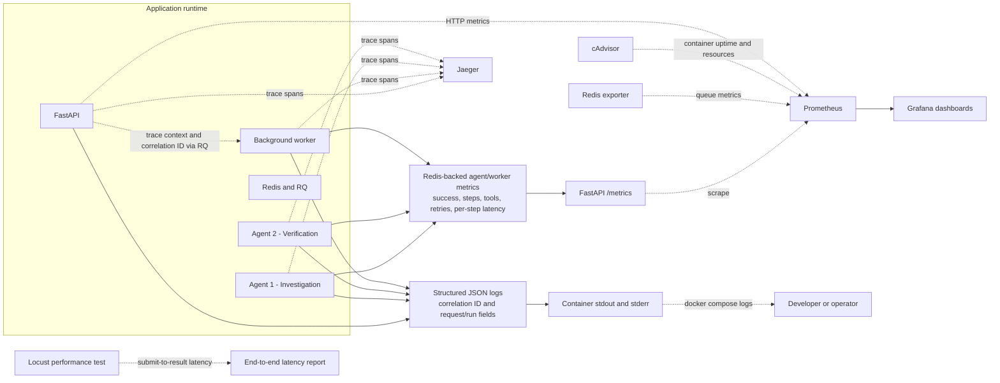
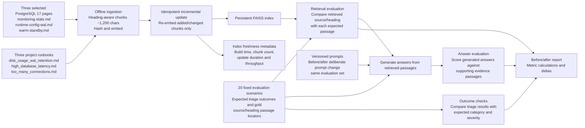

<h1 align="center">PostgreSQL Incident Triage Assistant</h1>

<p align="center">
  <strong>Investigate database incidents. Get safe next steps with runbook sources.</strong>
</p>

<p align="center">
  
  
  
  
  
  
  
  
  
  
  
  
  
</p>

<p align="center">
  Triage synthetic or replayed database alerts for high latency, connection exhaustion, and increasing disk usage. The FastAPI service uses supplied alert/context data and deterministic synthetic diagnostics only; it never connects to a live system or performs remediation.
</p>

---

## Project layout

```text
.
├── app/
│   ├── api/                                 # FastAPI routes and UI
│   ├── core/                                # environment settings and observability
│   ├── domain/                              # models, policies, safety, runbook types
│   ├── services/                            # triage, agents, retrieval, service ports
│   ├── infrastructure/
│   │   ├── diagnostics/                     # deterministic synthetic fixtures
│   │   ├── llm/                              # provider resilience and local model stub
│   │   ├── queue/                           # Redis/RQ queue and worker
│   │   ├── rag/                             # Groq, ingestion, and FAISS adapters
│   │   └── storage/                         # SQLite incident history
│   ├── main.py, worker.py                   # stable API and RQ entry points
│   └── __init__.py
├── corpus/runbooks/                         # the three selected runbooks
├── data/                                    # local SQLite history and optional RAG files
├── docs/                                    # brief, architecture, evaluation, operations
├── grafana/                                 # dashboard definitions
├── results/                                 # Locust CSV output
├── scripts/                                 # benchmarks, load tests, evaluation
├── tests/                                   # API, policy, queue, and RAG tests
├── .dockerignore, .env.example, .gitignore, README.md
└── Dockerfile, docker-compose.yml, prometheus.yml, pyproject.toml, uv.lock
```

The API, domain, services, and infrastructure layers have separate
responsibilities. `app.main:app` and `app.worker.process_triage` remain stable
entry points. RAG separates ingestion, indexing/storage, and generation; the
default triage path does not require RAG.
The original project brief is preserved in
[docs/MiniProject_08_Incident_Triage_Runbook_MLSD.txt](docs/MiniProject_08_Incident_Triage_Runbook_MLSD.txt).

## Architecture workflow

```mermaid
flowchart LR
    Alert[1. Synthetic or replayed alert<br/>Built-in scenario or recorded payload]
    UI[2. Frontend dashboard<br/>Submit alert and view result]
    API[3. FastAPI<br/>Validate request and quarantine invalid input]
    Queue[4. Redis queue and background worker<br/>Asynchronous run]
    Agent1[5. Multi-agent analysis<br/>Agent 1 investigates and gathers evidence]
    Tools[Shared tools<br/>Request lookup, corpus search, clause lookup]
    Mode{Retrieval mode}
    Keyword[Keyword search<br/>Default]
    FAISS[FAISS semantic search<br/>Optional RAG]
    Knowledge[6. Runbook knowledge<br/>Three runbooks and indexed documentation]
    Evidence[Retrieved passages and citations]
    Policy[7. Deterministic severity and routing]
    Candidate[Proposed cause, severity and steps<br/>with retrieved passages and citations]
    Agent2[5. Agent 2 - Verification and routing]
    Verified{Complete recommendation verified?}
    Retry{Alternate retrieval used?}
    Alternate[Alternate search strategy<br/>One retry]
    Recommendation[8. Verified recommendation<br/>Citations and safe first-response steps]
    Escalation[Human escalation<br/>Withhold unsupported recommendation]
    Result[9. SQLite history and Redis run status]
    Display[Frontend displays result]
    Quarantine[Quarantine invalid request]

    Alert --> UI --> API --> Queue --> Agent1
    API -. invalid payload .-> Quarantine
    Agent1 --> Tools --> Mode
    Mode -- Default --> Keyword
    Mode -- RAG enabled --> FAISS
    Knowledge --> Keyword
    Knowledge --> FAISS
    Keyword --> Evidence
    FAISS --> Evidence
    Evidence --> Policy --> Candidate --> Agent2 --> Verified
    Verified -- Yes --> Recommendation --> Result
    Verified -- No --> Retry
    Retry -- No --> Alternate --> Evidence
    Retry -- Yes --> Escalation --> Result
    Result --> Display
    Display -. feedback .-> API
```



Agent 2 verifies the complete proposed assessment: cause, severity,
recommended steps, retrieved passages, and citations. A failed check triggers
one alternate search and a second verification; if that also fails, the
unsupported recommendation is withheld and the incident is escalated.
Keyword search is the default retrieval path; enabling RAG switches corpus
search to FAISS semantic retrieval. Both are supporting tools used during
investigation.

### Two agents, three worker replicas

The two agents are workflow specialists that collaborate on **one incident**.
The three `agent-worker` containers are identical processing replicas; they are
not additional agents and do not have different specialties.

| Agent | Responsibility |
|---|---|
| Agent 1 - Investigation | Interprets the incident, searches documentation and gathers evidence for a proposed assessment. |
| Agent 2 - Verification | Checks the proposed cause, severity, recommended steps, retrieved passages, and citations. It requests one alternate search if needed and escalates if the recommendation remains unsupported. |

Severity and routing are determined by the application's deterministic policy;
Agent 2 verifies the proposed assessment rather than independently choosing
severity or routing.

Each worker listens to the same Redis `triage` queue. One worker takes a job and
runs the complete Agent 1 -> Agent 2 workflow; one incident is not split across
workers. With three replicas, up to three incidents can be processed at once:

| Worker replica | Example job | Workflow |
|---|---|---|
| Worker 1 | Incident 1 | Agent 1 -> Agent 2 |
| Worker 2 | Incident 2 | Agent 1 -> Agent 2 |
| Worker 3 | Incident 3 | Agent 1 -> Agent 2 |

For five incoming incidents, three are processed by the available workers and
the other two wait in Redis. As a worker finishes, it takes the next available
job. The worker numbers and incident assignments are illustrative; Redis/RQ
does not guarantee a particular replica-to-incident assignment.

### Diagram 2 - Application observability



Prometheus and Grafana observe the triage application and its infrastructure;
they do not detect incidents on a live PostgreSQL system. Jaeger receives
OpenTelemetry traces. Application logs are available from the local Compose
containers as structured JSON with correlation IDs; view them with
`docker compose logs`. There is no centralized log backend. Per-agent success
rates, steps/tool calls per run, verification retry rate, and per-step latency
are exported through the API metrics endpoint. The worker histogram measures
worker execution; Locust measures submit-to-final-result latency, including
queue wait. cAdvisor supplies container uptime and resource metrics.

### Diagram 3 - Offline LLMOps and evaluation



The three diagrams separate the request path from observability and offline
development; ingestion and evaluation do not run on an incident request.
The retrieval evaluator uses the corpus/index to check whether the expected
source passage was retrieved. Generated summaries are scored against retrieved
evidence passages, while the deterministic scenario suite checks expected
triage outcomes; the FAISS index is not an answer evaluator. Index metadata
records freshness and indexing statistics, and unchanged chunks keep their
existing embeddings. See
[docs/evaluation.md](docs/evaluation.md) for metric definitions and report
interpretation.

### Runtime design notes

- **Guardrails:** request schemas and local input/output checks protect
  model-bound incident, context, and retrieved text. Flagged input bypasses
  model calls. Summary output is checked for selected toxic phrases, unsafe
  remediation, unsupported cause assertions, length, and citations; rejected
  summaries leave deterministic triage in place. These pattern-based checks
  are not a general-purpose prompt-injection or toxicity classifier.
- **Agent and retrieval limits:** Agent 1 investigates with the shared
  request-lookup, corpus-search, and clause-lookup tools; Agent 2 verifies
  sources and citations. Tool selection is limited to four rounds and eight
  calls, verification gets at most one alternate retrieval, and RQ jobs have a
  120-second timeout.
- **Reliability and policy:** RAG and model-selected tools are optional.
  Bounded provider retries and a circuit breaker protect model calls; failures
  fall back to deterministic retrieval/triage. Severity, routing, and
  remediation recommendations remain deterministic and advisory.
- **LLMOps and observability:** prompt versions, model token usage, and
  provider token counts are recorded; cost estimates are included when token
  prices are configured. OpenTelemetry traces, application metrics, and
  queue/worker outcomes support operational diagnosis.
- **Platform and performance:** Redis/RQ tracks run status, SQLite stores
  incident history and feedback, and a bounded in-process LRU caches retrieval.
  `RATE_LIMIT_PER_MINUTE` controls submission rate. Locust measures full
  submit-to-result latency; see [docs/evaluation.md](docs/evaluation.md) for
  worker scaling and results.

The offline evaluator compares versioned RAG prompts on the same scenario set
and reports before/after deltas. Groundedness and faithfulness are reproducible
lexical proxies, not semantic or human-judged scores; details are in
[docs/evaluation.md](docs/evaluation.md). Further operational behavior is
documented in [docs/architecture.md](docs/architecture.md) and
[docs/service-operations.md](docs/service-operations.md).

## Getting started

### Phase 1 - Clone the project

#### 1. Check prerequisites

Install Git, Visual Studio Code, and Docker Desktop for Windows. Docker Desktop
includes Docker Compose. In PowerShell, check that the commands are available:

```powershell
git --version
docker --version
docker compose version
```

Start Docker Desktop before continuing.

#### 2. Clone the repository

In PowerShell, change to the parent folder where you want the project, then
clone it:

```powershell
Set-Location "$HOME\Desktop"
git clone https://github.com/proindra/Production-Incident-Triage.git
Set-Location Production-Incident-Triage
```

If your Desktop is in a different location, use that path instead. The current
directory should be the repository root, containing `docker-compose.yml`,
`Dockerfile`, and `pyproject.toml` (not just the `app` folder).

### Phase 2 - Open the project in VS Code

#### 3. Open the repository root

```powershell
code .
```

If the `code` command is unavailable, open VS Code and use **File > Open Folder**
to select the repository root. In VS Code, choose **Terminal > New Terminal**.
The terminal should start in the root directory; check with:

```powershell
Get-Location
```

### Phase 3 - Build and start the application

#### 4. Configure environment variables

For the default demo, creating `.env` is optional. The application runs
deterministically without a Groq API key; RAG and model-selected tools are
disabled by default. To create a local configuration file for later edits:

```powershell
if (-not (Test-Path .env)) {
    Copy-Item .env.example .env
}
```

Keep the default settings for the first run. Do not commit `.env`; it may
contain local credentials.

#### 5. Build and start Docker services

From the repository root, run:

```powershell
docker compose up --build
```

This builds the application image and starts the configured services. Keep this
terminal open while using the application. Compose waits for required
dependencies, such as healthy Redis, before starting dependent services.

#### 6. Verify the services

Open a second VS Code terminal in the repository root and run:

```powershell
docker compose ps
docker compose config --services
```

The default Compose project defines nine services and starts nine containers:

| Compose service | Purpose |
|---|---|
| `api` | FastAPI endpoints and web UI. |
| `agent-worker` | Processes queued triage runs; one replica by default. |
| `redis` | RQ job queue and shared runtime state. |
| `model-stub` | Local OpenAI-compatible model stub for testing. |
| `irt-redis-exporter` | Exports Redis metrics to Prometheus. |
| `cadvisor` | Reports container resource and uptime metrics. |
| `irt-prometheus` | Scrapes and stores metrics. |
| `irt-grafana` | Displays metrics dashboards. |
| `jaeger` | Receives and displays OpenTelemetry traces. |

The API, Redis, worker, and model stub have health checks. Other services may
show as running without a `healthy` status. `irt-prometheus` is the Prometheus
service and `irt-grafana` is the Grafana service. No live database or external
monitoring target is connected.

### Phase 4 - Open the application

#### 7. Open the web interface

Open the [web interface](http://localhost:8000/) to submit an incident, or the
[API documentation](http://localhost:8000/docs) to inspect and call the API.

### Phase 5 - Submit and follow a synthetic incident

#### 8. Choose a sample incident

In the web interface, select **Disk usage increasing** from the Synthetic Alert
Generator and click **Analyze incident**. The form fills in a synthetic
description and context. This is a demo scenario; it does not connect to a
production database or run live diagnostics.

#### 9. Understand the processing flow

1. FastAPI validates the request and puts a job on the Redis/RQ queue.
2. One available `agent-worker` picks up the job.
3. Agent 1 investigates and gathers evidence; Agent 2 verifies the proposed
   assessment and its citations.
4. Severity and routing are determined by deterministic policy.
5. The result is recorded in SQLite and made available through the run-status
   endpoint.

#### 10. Retrieve the result

The web interface polls for the result automatically. For a direct API request,
`POST /incidents/triage` returns `202 Accepted` with a `run_id` and `status_url`.
Poll the returned `status_url` until its status is `finished` or `failed`. The
status endpoint is `GET /incidents/runs/{run_id}`; when finished, the response
includes the result. `GET /health` checks API liveness, and `GET /ready` checks
Redis availability.

### Phase 6 - Check monitoring

After starting the services, open:

- Grafana: <http://localhost:2028>
- Prometheus: <http://localhost:2027>
- Jaeger: <http://localhost:2030>

These services provide dashboards, metrics, and traces.

### Phase 7 - Optionally scale workers

Each worker replica runs the complete two-agent workflow for one incident at a
time. To run three identical worker replicas, open another terminal in the
repository root and run:

```powershell
docker compose up -d --scale agent-worker=3
```

This allows up to three incidents to be processed concurrently; additional
jobs wait in Redis. The three replicas bring the total Compose container count
to 11.

### Phase 8 - Stop the application

Run this from the repository root when finished:

```powershell
docker compose down
```

This stops and removes the containers and network but preserves named volumes,
including incident history. Do not add `--volumes` if you want to keep that
data.

## Optional Groq and FAISS RAG

The default remains deterministic and makes no Groq requests. To enable the
RAG path, set `RAG_ENABLED=true` and `GROQ_API_KEY` in `.env`. If `.env` does
not exist, create it from `.env.example` using the command in the getting
started section; otherwise, edit the existing file so local settings are not
overwritten. The default Groq model is `openai/gpt-oss-120b`. Change
`GROQ_MODEL` to use another supported Groq model. The default embedding model is
`sentence-transformers/all-MiniLM-L6-v2`; change `RAG_EMBEDDING_MODEL` to use
another Sentence Transformers-compatible model. The key and any private model
configuration must not be committed. Compose passes the Groq key to worker
containers only.

Build the local FAISS index before starting RAG workers:

```powershell
Copy-Item .env.example .env
# Edit .env locally and set the RAG values above.
docker compose build agent-worker
docker compose run --rm agent-worker uv run --no-sync python -m app.infrastructure.rag.document_ingestion.fetch_docs --version 17 --destination /data/postgresql
docker compose run --rm agent-worker uv run --no-sync python -m app.infrastructure.rag.document_ingestion
docker compose up --build -d --scale agent-worker=3
```

The indexed corpus is the three selected PostgreSQL 17 pages
(`monitoring-stats.md`, `runtime-config-wal.md`, and `warm-standby.md`) plus
the three project runbooks in `corpus/runbooks/`. It does not include the full
PostgreSQL manual. Ingestion preserves Markdown headings and splits each
Markdown source into passages of approximately `RAG_CHUNK_SIZE` characters;
each passage retains its filename and heading metadata.

Sentence Transformers
downloads the configured model from Hugging Face on first use and creates local
embeddings using CPU-only PyTorch (no GPU/CUDA runtime required); normalized
vectors are searched by cosine similarity through FAISS. The fetch step adds
those selected official PostgreSQL 17 documentation pages to the index.
Re-running ingestion embeds only changed/new passages, removes deleted ones,
and rebuilds all vectors only if the embedding model changes. The model cache
and index are stored under the shared `/data` volume.

The LangGraph search tool uses FAISS in RAG mode. Groq generates a short
summary from retrieved passages; source citations are checked, and deterministic
severity, routing, and recommended actions remain authoritative. If generation
fails or its citations are invalid, the result clearly reports that it used
deterministic triage instead. The request description, redacted context, and
retrieved excerpts are sent to Groq when this mode is enabled. Do not send
confidential incident data unless your organization approves that provider use.

### Optional model-selected agent tools

Set `AGENT_TOOL_SELECTION_ENABLED=true` to let Groq select among the
request-field, corpus-search, and clause-lookup tools. The default is disabled;
the bounded deterministic flow remains available as a fallback, and model
selection cannot change severity, recommended actions, or perform remediation.
The option requires `GROQ_API_KEY` and `GROQ_MODEL`, but not RAG embeddings. For
a local compatibility check, configure the worker with
`GROQ_API_KEY=stub`, `GROQ_MODEL=stub-model`, and
`GROQ_BASE_URL=http://model-stub:8010/openai/v1`; the Compose `model-stub`
service is deterministic and does not contact Groq.

### RAG prompt evaluation

The evaluator runs on the host and uses the local `data/postgresql` and
`data/faiss` paths; the Compose index is stored in a separate named volume.
Export `GROQ_API_KEY` and `GROQ_MODEL` into the current PowerShell session (a
local `.env` file is loaded by Compose, not by `uv run`). The default
`RAG_EMBEDDING_MODEL` is used unless you override it. Then fetch and index the
corpus locally and compare the versioned prompts:

```powershell
uv run --locked python -m app.infrastructure.rag.document_ingestion.fetch_docs --version 17 --destination data/postgresql
uv run --locked python -m app.infrastructure.rag.document_ingestion
uv run --locked python -m scripts.evaluate_rag --output results/rag-evaluation.json
```

The report includes expected-source retrieval accuracy, sentence-level
groundedness, lexical faithfulness/hallucination proxies, citation validity,
before/after deltas, and per-case token/cost metadata. The lexical scores are
not semantic judgments; consult
[docs/evaluation.md](docs/evaluation.md) for their definitions and limitations.
The command makes model calls and can incur provider charges.

## Synthetic and replayed alerts

The project does not connect to a live database or monitoring system. Use the
browser's **Load a synthetic sample** selector or submit a recorded alert
payload to `POST /incidents/triage`. The sample metrics are user-supplied
scenario data; the worker does not collect or invent live measurements.
Severity, routing, retrieval, and evidence verification run on that supplied
payload.

## Monitoring stack

The supplied Compose and Prometheus files provide local metrics, dashboards,
and tracing. Prometheus scrapes every 15 seconds.

| Component | Local address | Purpose |
|---|---|---|
| Triage API | <http://localhost:8000/metrics> | Application request and triage metrics. |
| Prometheus | <http://localhost:2027/targets> | Metrics UI and scrape-target health. |
| Grafana | <http://localhost:2028> | Dashboards for API, worker, queue, and container metrics. |
| Jaeger | <http://localhost:2030> | OpenTelemetry trace UI. |
| cAdvisor | <http://localhost:2031/metrics> | Container resource and uptime metrics. |

Redis Exporter (`irt-redis-exporter:9121`) and the model stub
(`model-stub:8010`) are internal to the Compose network and are not published
on host ports.

The configured Prometheus scrape jobs cover the API, Prometheus itself, Redis
Exporter, Jaeger, Grafana, cAdvisor, and the model stub. PostgreSQL metrics
are not scraped; this application does not connect to a live PostgreSQL
instance.

### Local container access and credentials

| Service/container | Local address | Username | Password | Notes |
|---|---|---|---|---|
| Grafana (`irt-grafana`) | <http://localhost:2028> | `admin` | `local_grafana_password` | Grafana UI login. |
| Prometheus (`irt-prometheus`) | <http://localhost:2027> | None | None | No authentication is configured in the supplied local Compose setup. |
| Triage API | <http://localhost:8000> | None | None | No authentication is configured; run locally only. |

Prometheus and the API are unauthenticated in this development setup. Do not
expose them to an untrusted network.

```powershell
docker compose config
docker compose up --build -d
docker compose ps
```

Check <http://localhost:2027/targets> for the configured local scrape targets.
Traces are available in Jaeger at <http://localhost:2030>. In Grafana, add a
Prometheus data source with URL `http://irt-prometheus:9090` (Grafana must use
the container-network URL, not `localhost:2027`).
The checked-in dashboard at
[`grafana/incident-triage-dashboard.json`](grafana/incident-triage-dashboard.json)
contains triage API, worker, queue, and local container metrics only. Import it
from Grafana's dashboard UI and select the `Incident Triage Prometheus` data
source. It does not display PostgreSQL target metrics.

## Safety and limitations

- Triage is advisory; no remediation endpoint or automatic database change
  exists. Dropping slots, deleting WAL, terminating sessions, and changing
  server settings are explicitly refused.
- User context is treated as reported evidence, not as a diagnostic result.
- Severity thresholds are project defaults in `app/domain/policies.py`; teams should
  replace them with their approved incident policy.
- The default uses keyword retrieval; optional RAG mode uses local embeddings
  and FAISS, while citations are checked against the original runbook text.
- The default SQLite history is local at `data/incidents.db` and is not intended
  as shared or production storage.
- The demo UI is intentionally small and should be protected behind suitable
  authentication and network controls before any shared deployment.
- Deterministic triage is the default. Optional Groq generation records prompt
  versions and token counts; cost estimates require configured token prices.
  Local lexical safety checks and the prompt evaluation workflow are included,
  but they are not a substitute for human review or a general-purpose safety
  classifier.

See [architecture and failure behavior](docs/architecture.md),
[service operations and incident log](docs/service-operations.md), and
the [evaluation guide](docs/evaluation.md).
